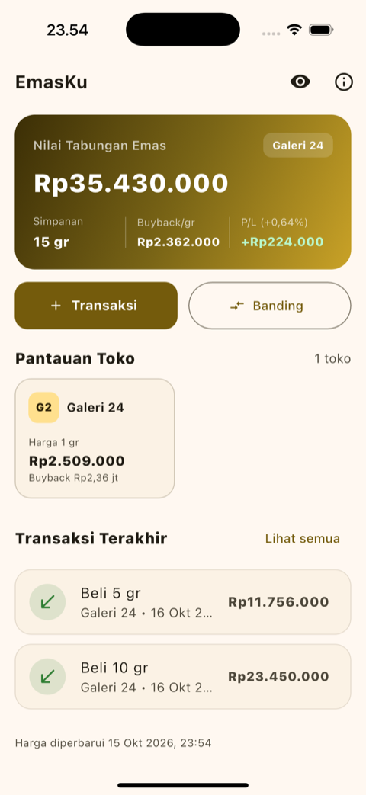
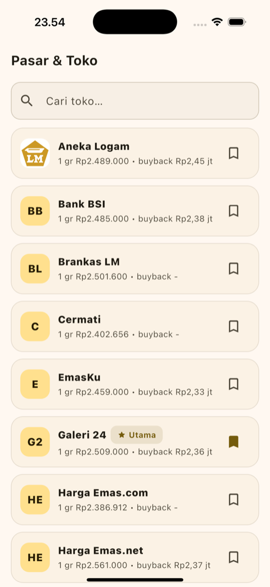
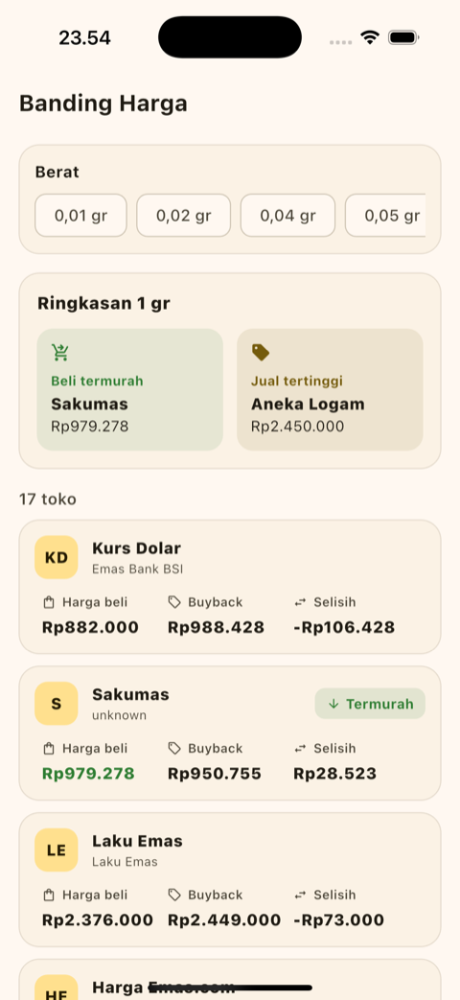
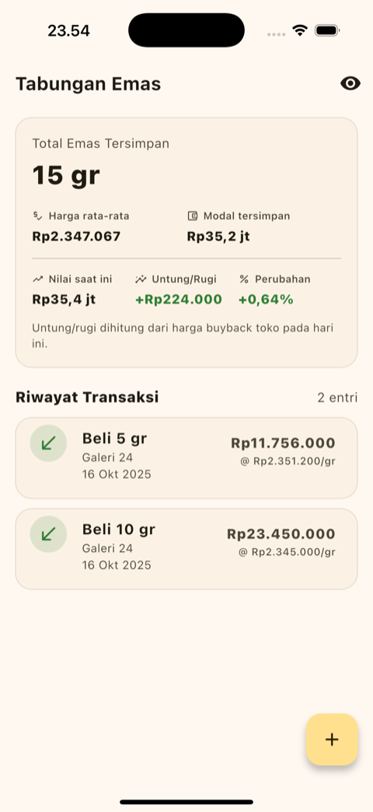
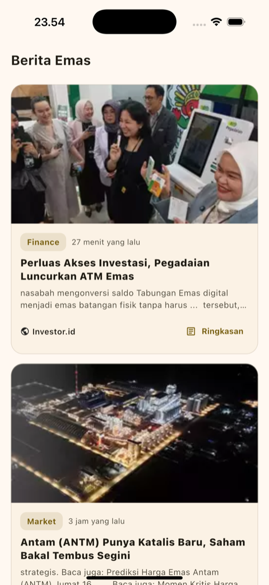
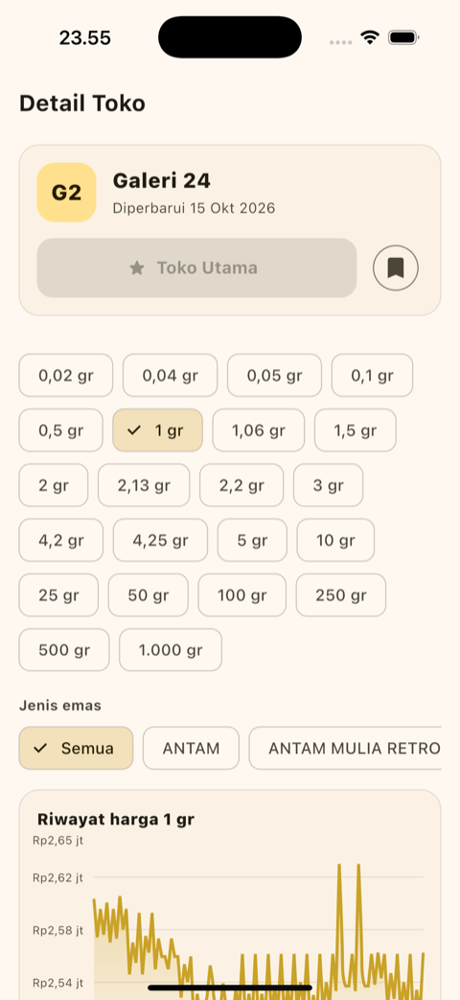
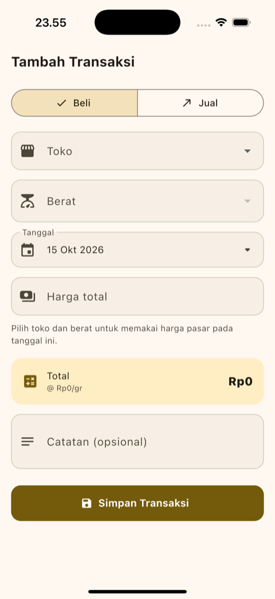

<div align="center">

# EmasKu

**Aplikasi tabungan emas & pembanding harga toko (Indonesia)**

Catat transaksi beli/jual emas, pantau nilai & untung/rugi dari harga **buyback** toko,
dan bandingkan harga antar toko — dalam satu aplikasi.

[](https://flutter.dev)
[](https://dart.dev)
[](https://pub.dev/packages/get)
[]()
[](test)

</div>

---

## Ringkasan

**EmasKu** adalah aplikasi mobile untuk **menabung emas** dan **membandingkan harga antar toko**

- **Harga & berita**: diambil langsung dari API publik
  **[logam-mulia-api](https://github.com/iamutaki/logam-mulia-api)** (18 toko/vendor + berita Investor.id).
- **Data tabungan** (transaksi beli/jual): disimpan **lokal di perangkat** memakai SQLite — **tanpa login, tanpa server**.

Prinsip utamanya sederhana: catat emas yang kamu beli, lalu biarkan aplikasi menghitung
nilai terkini dan untung/rugi dari **harga buyback** toko, sekaligus membantu memilih toko
termurah.

## Tangkapan layar

<p align="center">
  
  
  
</p>
<p align="center">
  
  
  
  
</p>

<p align="center"><sub>Beranda · Pasar · Banding · Tabungan · Berita · Detail Toko · Tambah Transaksi</sub></p>

---

## Fitur

### 🏠 Beranda
Kartu hero berisi **nilai tabungan**, **simpanan (gram)**, **harga buyback/gram** toko utama,
dan **untung/rugi**. Di bawahnya ada pantauan toko (watchlist) dan transaksi terakhir.
- **Tombol mata (privasi)**: menyembunyikan nominal tabungan (Nilai, Simpanan, P/L, dan angka di tab Tabungan). Harga publik tetap tampil.
- **Pull-to-refresh** untuk memuat harga terbaru.

### 🏪 Pasar
Daftar 18 toko dari API dengan pencarian. Tandai toko dengan ikon **bookmark** untuk memantau;
toko utama ditandai **"Utama"**.

### 📈 Banding
Pilih berat (mis. 1 gr) → lihat **harga beli** & **buyback** semua toko berdampingan,
dengan penanda **"Termurah"** (beli termurah) dan **"Jual terbaik"** (buyback tertinggi).
Toko dengan kutipan tidak wajar (buyback > harga beli) tidak diikutkan sebagai pemenang.

### 💰 Tabungan
Catat transaksi **Beli/Jual** emas. Ringkasan menampilkan total gram, harga rata-rata,
modal tersimpan, nilai saat ini, dan untung/rugi.

### 📰 Berita
Berita emas dari Investor.id. Tap kartu → buka **browser default**; tombol **"Ringkasan"** → baca di dalam aplikasi.

### 🔍 Detail Toko
Harga terbaru per berat, **filter "Jenis emas"** (Semua / ANTAM / UBS / …), dan **grafik riwayat harga**.

---

## Cara kerja

### Sumber data
```
Aplikasi  ──HTTP──▶  logam-mulia-api.iamutaki.workers.dev
                        ├─ GET /api/prices                      → daftar toko
                        ├─ GET /api/prices/:toko                → harga terbaru
                        ├─ GET /api/prices/:toko/history        → riwayat harga
                        └─ GET /api/news/investor-id[/detail]   → berita
```
`PriceController` memuat daftar toko lalu harga terbaru **semua toko sekaligus**.
Riwayat harga di-cache di memori per (toko, berat, material).

### Perhitungan portofolio & P/L
Valuasi memakai **harga buyback** toko utama (harga kamu **jual** balik), bukan harga beli:

```
gramDimiliki  = Σ berat beli − Σ berat jual
modalBersih   = Σ total beli − Σ total jual            (total = berat × harga/gram)
hargaRata2    = Σ total beli ÷ Σ berat beli
nilaiSaatIni  = gramDimiliki × harga buyback/gram toko utama (hari ini)
untungRugi    = nilaiSaatIni − modalBersih
perubahan %   = untungRugi ÷ modalBersih × 100
```

> Catatan: ini **rata-rata sederhana** (bukan FIFO). Transaksi "Jual" mengurangi modal
> bersih secara linear; belum memisahkan untung terealisasi vs belum.
> Jika toko tidak punya harga buyback, nilai jatuh ke harga jual.

### Harga transaksi mengikuti tanggal
Saat menambah transaksi, harga **diisi otomatis** dari `.../history` — harga toko
**pada atau sebelum** tanggal transaksi — sehingga transaksi lama memakai harga saat itu,
bukan harga hari ini. Tetap bisa diubah manual (harga custom/negosiasi).

### Format angka
Input "Harga total" memakai pemisah ribuan otomatis (`Rp24.500.000`). **Total = nilai yang
diisi** (tidak dikali berat lagi). Harga internal disimpan per gram (`total ÷ berat`).

### Penyimpanan lokal
Tabel `transactions` di SQLite (`emasku.db`) menyimpan transaksi. Preferensi
(toko utama, watchlist, tema, mode privasi) di `shared_preferences`.

---

## Arsitektur

```
lib/
├── main.dart                    # bootstrap: init locale, DB, DI (GetX), runApp
├── app/
│   ├── app.dart                 # root widget (GetMaterialApp)
│   └── theme/app_theme.dart     # tema Material 3 (emas, light + dark)
├── core/
│   ├── config/app_config.dart   # base URL & konstanta
│   └── utils/
│       ├── formatters.dart      # Fmt: format Rp, tanggal, angka input
│       └── portfolio.dart       # Portfolio: logika portofolio murni (mudah dites)
├── controllers/                 # state GetX
│   ├── price_controller.dart        # daftar toko, harga, riwayat, valuasi
│   ├── watchlist_controller.dart    # toko utama + pantauan
│   ├── transaction_controller.dart  # CRUD transaksi
│   ├── news_controller.dart         # berita
│   └── privacy_controller.dart      # toggle sembunyikan nominal
├── data/
│   ├── api/                     # api_client.dart, api_exception.dart
│   ├── local/                   # local_database.dart (sqflite), prefs_store.dart
│   ├── models/                  # satu kelas per file + models.dart (barrel)
│   └── repositories/            # transaction_repository.dart
├── screens/                     # per fitur
│   ├── shell/main_shell.dart        # bottom navigation
│   ├── dashboard/dashboard_page.dart
│   ├── market/market_page.dart, vendor_detail_page.dart
│   ├── compare/compare_page.dart, compare_entry.dart
│   ├── savings/savings_page.dart, transaction_form_page.dart
│   └── news/news_page.dart, news_detail_page.dart
└── widgets/                     # satu widget per file + widgets.dart (barrel)
```

Pola: **screen (UI) → controller (GetX) → repository/api + local store → model**.
Impor internal memakai `package:emaskuid/...` supaya aman saat file dipindah.

## Tech stack

| Area | Paket |
|------|-------|
| Framework | Flutter 3.38 · Dart 3.10 |
| State / routing / DI | `get` (GetX) |
| HTTP | `dio` |
| Database lokal | `sqflite` · `path` |
| Preferensi | `shared_preferences` |
| Grafik | `fl_chart` |
| Format | `intl` (locale `id_ID`) |
| Gambar | `cached_network_image` |
| Loading | `shimmer` |
| Buka browser | `url_launcher` |
| Test | `flutter_test` · `sqflite_common_ffi` |

## API yang dipakai

| Endpoint | Fungsi |
|----------|--------|
| `GET /health` | Status API (dialog "Tentang") |
| `GET /api/prices` | Daftar toko/vendor |
| `GET /api/prices/:source` | Harga terbaru sebuah toko |
| `GET /api/prices/:source/history` | Riwayat harga (filter berat/material) |
| `GET /api/news/investor-id` | Daftar berita |
| `GET /api/news/investor-id/detail?url=` | Detail berita |

Base URL: `https://logam-mulia-api.iamutaki.workers.dev` (lihat `lib/core/config/app_config.dart`).

---

## Menjalankan

**Prasyarat:** Flutter `>= 3.38` dan Dart `>= 3.10`.

```bash
# 1. Ambil dependency
flutter pub get

# 2. Jalankan (pilih device/emulator)
flutter run

# 3. Build rilis
flutter build apk        # Android
flutter build ios        # iOS (butuh Xcode & CocoaPods)
```

Data toko & berita butuh koneksi internet. Data tabungan tetap bisa dibuka offline.

## Testing

```bash
flutter test
```

| File | Isi |
|------|-----|
| `test/portfolio_test.dart` | Logika portofolio (gram, modal, rata-rata, P/L) & parsing harga |
| `test/price_on_date_test.dart` | Harga berdasarkan tanggal (persis / sebelum / setelah data) |
| `test/valuation_test.dart` | Valuasi memakai buyback + fallback harga jual |
| `test/currency_format_test.dart` | Format angka input (pemisah ribuan) |
| `test/local_persistence_test.dart` | Transaksi bertahan setelah restart (SQLite asli) |
| `test/pages_smoke_test.dart` | Render Pasar/Banding/Berita + ikon bookmark + masking privasi |

---

## Catatan & batasan

- **P/L** memakai rata-rata sederhana, bukan FIFO; untung terealisasi belum dipisah.
- Butuh **toko utama** dipilih agar nilai & P/L muncul.
- Riwayat harga memakai hingga 200 baris terbaru per toko/berat; tanggal yang lebih lama → isi harga manual.
- Harga `0` di API dianggap "tidak tersedia" (bukan gratis).
- Endpoint detail berita kadang mengembalikan **403 dari sumbernya** (bukan bug app); UI menampilkan ringkasan + tombol coba lagi.
- Nama paket: `emaskuid`; nama tampilan aplikasi: **EmasKu**.

## Kredit

- Data harga & berita: **[iamutaki/logam-mulia-api](https://github.com/iamutaki/logam-mulia-api)** (MIT).
- Dibangun dengan Flutter & GetX.
